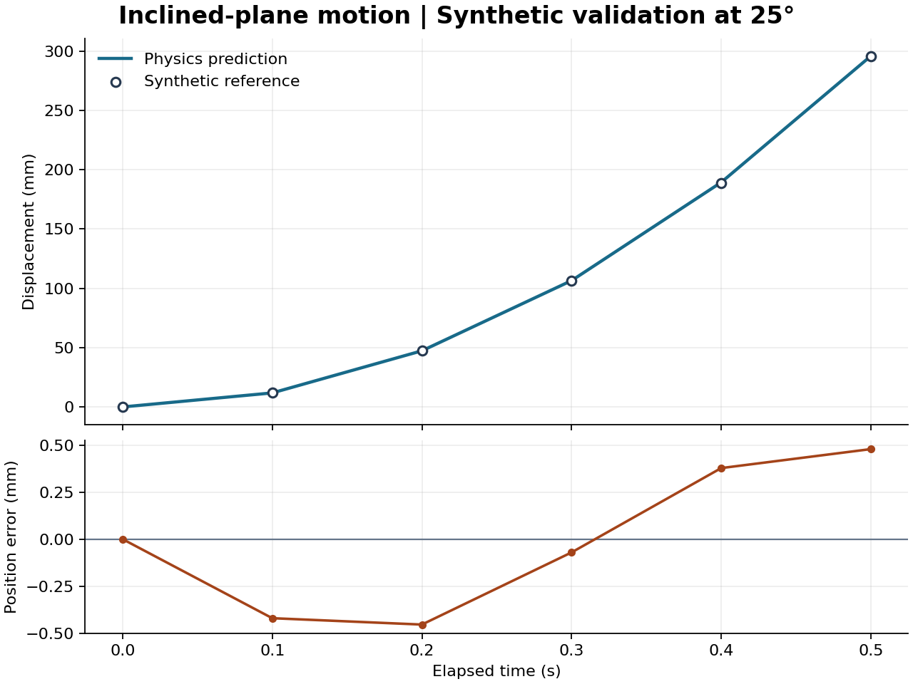

# Vision-Based Validation of Motion Simulations Using YOLO

**Orkun Sevengil | M.Sc. Graduation Project**

How closely does a physics model reproduce motion measured in video? This project compares measured and simulated trajectories for an object released from rest on an incline. It estimates friction from a calibration run and evaluates that estimate on a separate run.

## Run the validation

Requires Python 3.10 or newer. Each input CSV must have `time_s` and `position_m` columns. Supply elapsed time and displacement along the incline, both starting at zero at release. Use a different recording for validation.

    python validate.py examples/calibration.csv examples/validation.csv --calibration-angle 20 --validation-angle 25

The bundled CSVs contain synthetic example trajectories. The calibration example uses a kinetic friction coefficient of 0.20. The validation example uses a different angle and includes a small synthetic measurement offset.

The program writes a comparison CSV and reports fitted friction, mean absolute position error and root mean squared position error. The model assumes straight-line sliding with constant kinetic friction.

## Results on synthetic data

Friction was fitted using the 20° reference trajectory. The same coefficient was used to predict motion at 25°, where the separate reference trajectory contains a synthetic position offset.

| Metric | Result |
| --- | ---: |
| Fitted kinetic friction coefficient | 0.20000 |
| Mean absolute position error (MAE) at 25° | 0.301 mm |
| Root mean squared position error (RMSE) at 25° | 0.356 mm |

[Download the per-sample comparison CSV](results/synthetic_comparison.csv).

## Project status

The trajectory comparison works with measured CSV inputs. The planned YOLO stage will detect the object, track its position across frames, and apply camera calibration to export those inputs.

Detection precision, recall, and F1 can be reported after testing YOLO on labeled video frames. The table above measures trajectory prediction error on synthetic inputs.
